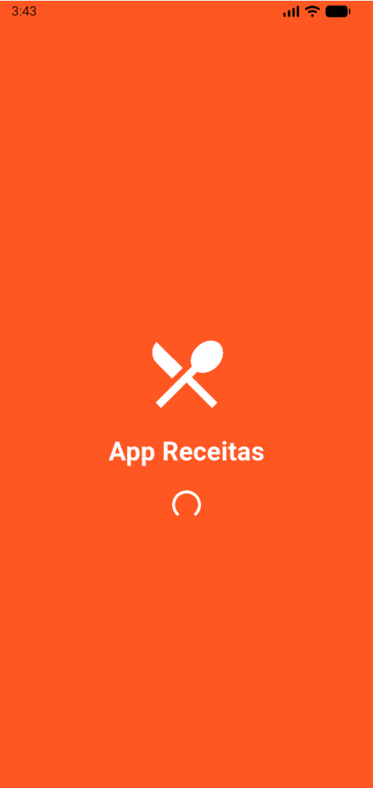
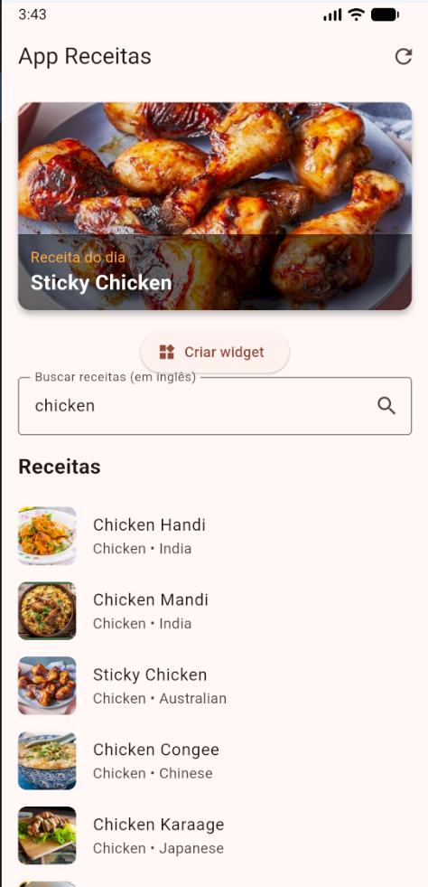
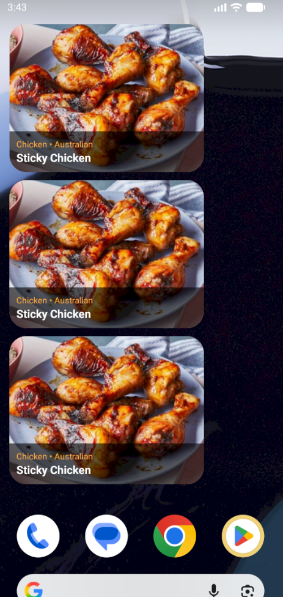

# Flutter Widget Externo – Home Screen Widget e Widget Personalizado

Aplicativo desenvolvido em Flutter para a atividade da **Aula 07 – Home Screen Widget e Widget personalizado** do curso de Desenvolvimento de Sistemas.

O aplicativo é um **App de Receitas** que consome uma API REST para exibir pratos e receitas. Ele possui **widgets personalizados** dentro do app e um **Home Screen Widget**, que mostra o nome e a foto de uma receita aleatória diretamente na tela inicial do Android.

---

## Sobre o projeto

O objetivo do projeto é trabalhar com widgets no Flutter, tanto os componentes visuais criados dentro do app (widgets personalizados) quanto o widget que fica na tela inicial do dispositivo (Home Screen Widget).

O aplicativo permite:

- Visualizar uma tela de abertura (splash) animada;
- Consumir uma API REST de receitas;
- Visualizar uma receita aleatória com nome e foto;
- Buscar e listar receitas;
- Ver os detalhes de uma receita (ingredientes e modo de preparo);
- Criar o widget pelo botão **Criar widget**;
- Exibir a receita do dia no Home Screen Widget (Android);
- Abrir o app na tela Home ao clicar no widget.

---

## Tecnologias utilizadas

- **Flutter**
- **Dart**
- **home_widget**
- **http**
- **path_provider**
- **Kotlin / XML** (parte nativa do Home Screen Widget no Android)
- **TheMealDB** (API REST de receitas)

---

## Funcionalidades

### Splash animada

Ao abrir, o app mostra uma tela de abertura com animação de escala e fade, e depois segue para a tela Home.

---

### Widget personalizado

Dentro do app foram criados widgets personalizados, estendendo `StatelessWidget`:

- **`MeuInfoWidget`**: exibe uma informação com ícone, usando `Container`, `Row`, `Icon` e `Text`. É exibido ao clicar no botão **Criar widget**.
- **`ReceitaAleatoriaWidget`**: exibe a foto e o nome de uma receita aleatória. Ao ser clicado, abre os detalhes da receita.

---

### Home Screen Widget

O widget da tela inicial do Android exibe:

- Ícone de receita;
- Foto da receita aleatória;
- Nome e categoria/origem da receita.

Ao clicar no widget, o app é aberto na tela Home com a lista de receitas.

O widget é atualizado sempre que o app carrega uma nova receita aleatória (botão de atualizar na barra superior).

---

### Botão Criar widget

Ao tocar no botão, o app exibe o `MeuInfoWidget` e, no Android, abre o pedido do sistema para fixar o Home Screen Widget na tela inicial.

> O Home Screen Widget só existe no Android. No Chrome o app funciona normalmente, mas sem esse widget.

---

## Telas do aplicativo

### Ícone do aplicativo



### Tela inicial

Tela principal do aplicativo, com a receita do dia e a lista de receitas.



### Widget na tela inicial do dispositivo

Home Screen Widget em ação, exibindo a foto e o nome de uma receita aleatória.



---

## Como executar o projeto

### 1. Clonar o repositório

```bash
git clone URL_DO_SEU_REPOSITORIO
```

### 2. Entrar na pasta do projeto

```bash
cd flutter_widget_externo
```

### 3. Gerar as plataformas e instalar o widget nativo (somente na 1ª vez)

```bash
dart tool/setup.dart
```

Esse comando gera as pastas `android/` e `web/`, copia os arquivos nativos do widget, registra o widget no `AndroidManifest.xml`, adiciona a permissão de internet e executa `flutter pub get`.

### 4. Executar o aplicativo

Para executar no navegador:

```bash
flutter run -d chrome
```

Para executar no emulador Android (com o Home Screen Widget):

```bash
flutter run
```

### 5. Adicionar o widget à tela inicial (Android)

1. Abra o app e aguarde a receita carregar;
2. Volte à tela inicial do emulador;
3. Segure em um espaço vazio e toque em **Widgets**;
4. Procure **flutter_widget_externo** e arraste o widget para a tela.

Também é possível usar o botão **Criar widget** dentro do app.

---

## Dependências

As principais dependências utilizadas no projeto são:

```yaml
dependencies:
  flutter:
    sdk: flutter

  http: ^1.2.0
  home_widget: ^0.7.0
  path_provider: ^2.1.0
```

---

## Como funciona o Home Screen Widget

1. O app busca uma receita aleatória na API;
2. A foto é baixada e salva em um arquivo no dispositivo;
3. O pacote `home_widget` salva o título, a categoria e o caminho da imagem;
4. O `HomeWidget.updateWidget` avisa o Android que o widget deve ser redesenhado;
5. O `ReceitaWidgetProvider` (Kotlin) lê esses dados e monta o layout `receita_widget.xml`;
6. Ao clicar no widget, o app é aberto.

---

## Estrutura do projeto

```text
flutter_widget_externo/
│
├── android/                      (gerado pelo setup)
├── web/                          (gerado pelo setup)
│
├── lib/
│   ├── main.dart
│   │
│   ├── models/
│   │   └── receita.dart
│   │
│   ├── services/
│   │   ├── api_service.dart
│   │   └── widget_service.dart
│   │
│   ├── screens/
│   │   ├── splash.dart
│   │   ├── home.dart
│   │   └── detalhes.dart
│   │
│   └── widgets/
│       ├── meu_info_widget.dart
│       └── receita_aleatoria_widget.dart
│
├── native_widget/                (arquivos nativos copiados pelo setup)
│   ├── kotlin/ReceitaWidgetProvider.kt
│   └── res/
│       ├── layout/receita_widget.xml
│       ├── xml/receita_widget_info.xml
│       └── drawable/
│
├── tool/
│   └── setup.dart
│
├── assets/
│   └── screenshots/
│       ├── icone.png
│       ├── tela.png
│       └── widget.png
│
├── test/
├── pubspec.yaml
└── README.md
```

---

## Imagens do projeto

As capturas de tela utilizadas neste README estão armazenadas em:

```text
assets/
```

Arquivos:

```text
icone.png
tela.png
widget.png
```

---

## Projeto desenvolvido para

**Curso:** Desenvolvimento de Sistemas  
**Atividade:** Aula 07 - Home Screen Widget e Widget personalizado  
**Tecnologia:** Flutter

---

## Autora

**Clara Andrzejewsky Antonacci**

Projeto desenvolvido como atividade acadêmica do curso de Desenvolvimento de Sistemas.
